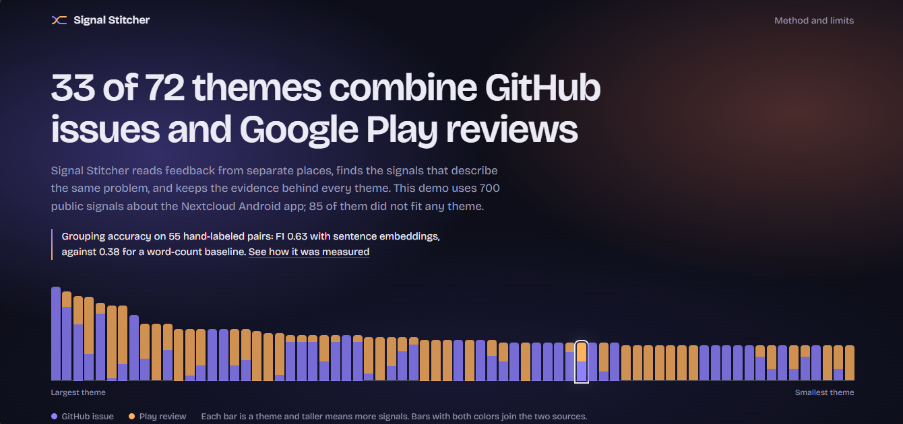
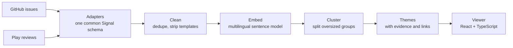

<div align="center">

# Signal Stitcher

**Customer feedback lives in many places. This finds the signals that describe the same problem, and keeps the evidence.**


[](https://signal-stitcher-nextcloud.netlify.app/)

[**Open the live demo**](https://signal-stitcher-nextcloud.netlify.app/)

</div>

---

I built this as a proof of work for the engineering problem in HyperOrbit's *Full Stack AI Engineer Intern* posting: ingestion from many sources, theme clustering, and a Signal Desk. It is independent work on public data and is not affiliated with HyperOrbit.

## At a glance

| 1,338 signals collected | 700 kept after cleaning | 72 themes | 33 themes join GitHub and Play |
|:---:|:---:|:---:|:---:|

Public feedback about the Nextcloud Android app, collected in October 2026: GitHub issues and Google Play reviews.

## The problem

The same problem shows up in different words in different places. Here is a pair I labeled as the same problem:

| Source | What was said |
|---|---|
| Play review, 3 stars | "I mainly use the app for auto-uploading all my photos, but the feature is unreliable. Some are skipped, will not be uploaded in future attempts…" |
| GitHub issue | "(feature: auto upload) Auto-upload stuck on an image" |

A system that counts these separately undercounts the problem. Signal Stitcher puts signals like these in one theme and shows both.

## How it works



| Step | What it does |
|---|---|
| **Adapters** | One small class per source. Each turns raw records into the same `Signal` shape. |
| **Clean** | Removes issue-template text, device blocks, release trackers and one-word reviews. Every drop is kept with a reason. |
| **Embed** | A multilingual sentence model turns each text into a vector, so a German issue can match an English review. |
| **Cluster** | Agglomerative clustering on cosine distance. Groups above 50 signals are split again. Three or more signals make a theme. |
| **Viewer** | Pick a theme and read the evidence behind it, with a link back to each original. |

## Does it work? I measured it

I hand-labeled **55 GitHub-vs-Play pairs** (32 "same problem", 23 "different") with one rule: *would a single developer fix solve both?* Then I scored each method on whether it put both signals of a pair in the same theme.

```
F1 on 55 hand-labeled pairs

word-count baseline (TF-IDF)       ████████░░░░░░░░░░░░  0.38
embeddings, full text (demo)       █████████████░░░░░░░  0.63
embeddings, GitHub title only      █████████████░░░░░░░  0.67
```

| Method | F1 | Precision | Recall |
|---|---|---|---|
| Word-count baseline (TF-IDF) | 0.38 | 0.80 | 0.25 |
| Sentence embeddings, full text (**used in the demo**) | 0.63 | 0.72 | 0.56 |
| Sentence embeddings, GitHub title only | 0.67 | 0.76 | 0.59 |

- Embeddings find about twice as many true cross-source matches as word counting. That gap is large.
- Title-only vs full text (0.67 vs 0.63) is **within noise** at this sample size, since one pair moves F1 by about 2-3 points. I kept full text because its score stays steady across thresholds while title-only swings.
- **A hypothesis that did not hold up:** that embedding only GitHub titles, which look more like short reviews, would fix the cross-source split.

<details>
<summary><strong>Where it goes wrong</strong></summary>

- Very short or vague reviews ("still not working custom folder") are hard to match to anything.
- Issues with an uninformative title ("error") fail in title-only mode.
- "Same area, different problem" joins: embeddings capture the topic (auto upload) better than the specific failure.
- Auto-upload complaints still end up split across several themes, partly by writing style: long issues versus short reviews.

</details>

<details>
<summary><strong>Limits of this evaluation</strong></summary>

- Only 55 pairs, labeled by one person, so there is no agreement check.
- The pairs came from similar-looking pools plus random ones, so recall means "among these labeled pairs", not among all possible pairs.
- The clustering threshold was chosen on the same labels, so the numbers are slightly optimistic.
- It reconciles **problems across sources**. It does not identify the same *customer* across sources, because public data has no shared identity.

</details>

## Run it

Requires Python 3.10+ and Node.js.

```bash
pip install -r requirements.txt scikit-learn sentence-transformers
export GITHUB_TOKEN=your_token      # optional, avoids GitHub rate limits

python collect.py                   # 1. collect GitHub issues + Play reviews -> data/signals.jsonl
python clean.py                     # 2. strip templates, drop junk          -> data/clean.jsonl
python cluster.py --threshold 0.6   # 3. embed + cluster                     -> data/themes_embeddings.json
python evaluate.py                  # 4. score against data/labels.jsonl
python export_viewer_data.py        # 5. write viewer/public/data.json

cd viewer && npm install && npm run dev
```

`python label_pairs.py` is the small terminal tool I used to create the labels.

## Add a new source

A source is one class with two methods (see `adapters/base.py`), plus one line in `collect.py`:

```python
class MySourceAdapter(Adapter):
    name = "my_source"

    def fetch(self, since, limit):      # yield raw records, newest first
        ...

    def normalize(self, raw):           # raw record -> Signal (or None to skip)
        return Signal(source=self.name, source_id=..., account=..., url=..., author=...,
                      text=..., created_at=..., ingested_at=now_iso())
```

The runner handles incremental sync, de-duplication (by id and by text), and output. The two existing adapters already differ in shape: GitHub is a REST API, Play uses a scraper library.

## Project layout

```
adapters/               Signal schema, Adapter interface, GitHub + Play adapters
collect.py              run all adapters, dedupe, incremental sync
clean.py                template text, device blocks, release trackers, low-value reviews
cluster.py              embeddings (or TF-IDF baseline), clustering, evidence selection
evaluate.py             precision / recall / F1 against hand labels, threshold sweep
label_pairs.py          terminal tool for labeling pairs
export_viewer_data.py   themes -> viewer JSON
viewer/                 React + TypeScript viewer
data/labels.jsonl       my 55 labels (data/pairs.json holds the pairs)
```

## Data notes

- All data is public. The viewer shows short excerpts with a link back to the source and does not include author names. Text belongs to its authors.
- GitHub links open the exact issue. Google Play has no public link to a single review, so Play cards link to the app page.
- Play reviews were collected with the unofficial `google-play-scraper` library. It can break if Google changes its pages and sits in a gray area of Google's terms, so treat it as demo-grade.
- Raw collected files (with author names) are not committed. Regenerate them with `collect.py`.

## What I would do next

- Name themes with an LLM instead of keywords (today: top keywords plus one real example line).
- Add a transparent ranking per theme: volume, recency, severity.
- Split vague catch-all themes and improve matching for short reviews.
- Add a third source to test the adapter interface further.
- Label more pairs, with a second labeler.

---

<div align="center">

Built by [Muhammad Hafiz](https://github.com/Hafiz12112003)

</div>
